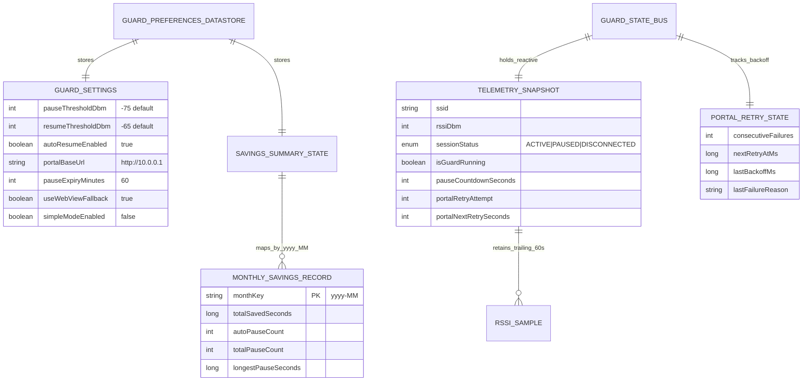

<div align="center">

### Eltharion Engineering

---

# Eltharion
## Software Design Document (SDD)
### Version 01.00

</div>

---

| | |
| :--- | :--- |
| **Eltharion** | **Version:** 01.00 |
| **Software Design Document** | **Date:** 11/15/2026 |
| **Document Identifier:** SDD-ELTHARION-01.00 | **Package ID:** `com.aistudio.lpbguard.kqwmzx` |

## Revision History

| Date | Version | Description | Author |
| :--- | :--- | :--- | :--- |
| 11/15/2026 | 01.00 | Document Creation | Eltharion Engineering |

---

## Table of Contents

- [1. Introduction](#1-introduction)
  - [1.1 Purpose](#11-purpose)
  - [1.2 Scope](#12-scope)
  - [1.3 System Overview](#13-system-overview)
  - [1.4 Reference Material](#14-reference-material)
  - [1.5 Definitions and Acronyms](#15-definitions-and-acronyms)
- [2. System Architecture](#2-system-architecture)
  - [2.1 Architectural Pattern](#21-architectural-pattern)
  - [2.2 Atomic Methodology Implementation](#22-atomic-methodology-implementation)
  - [2.3 Data Flow & Integration](#23-data-flow--integration)
- [3. Design System & UI/UX (Foundational Elements)](#3-design-system--uiux-foundational-elements)
  - [3.1 Design Tokens (The Atoms)](#31-design-tokens-the-atoms)
    - [3.1.1 Color Palette](#311-color-palette)
    - [3.1.2 Typography](#312-typography)
    - [3.1.3 Spacing and Grid](#313-spacing-and-grid)
    - [3.1.4 Iconography](#314-iconography)
  - [3.2 Component Library (Atoms & Molecules)](#32-component-library-atoms--molecules)
    - [3.2.1 Atoms](#321-atoms)
    - [3.2.2 Molecules](#322-molecules)
  - [3.3 Design Rationale & Accessibility](#33-design-rationale--accessibility)
    - [3.3.1 UX Rationale](#331-ux-rationale)
    - [3.3.2 Accessibility (a11y)](#332-accessibility-a11y)
- [4. Atomic System Design](#4-atomic-system-design)
  - [4.1 Component Decomposition (The Organisms)](#41-component-decomposition-the-organisms)
    - [4.1.1 Adaptive Navigation Shell (`MinimalBottomBar` & `NavigationRail`)](#411-adaptive-navigation-shell-minimalbottombar--navigationrail)
    - [4.1.2 Telemetry & Visualization Organisms](#412-telemetry--visualization-organisms)
    - [4.1.3 Battery Optimization & Savings Organisms](#413-battery-optimization--savings-organisms)
  - [4.2 Templates & Page Layouts](#42-templates--page-layouts)
    - [4.2.1 Primary Screen & Helper Layouts](#421-primary-screen--helper-layouts)
- [5. Data Design](#5-data-design)
  - [5.1 Data Schema](#51-data-schema)
  - [5.2 API & Bridge Design](#52-api--bridge-design)
    - [5.2.1 Portal Endpoints & Service Intent Actions](#521-portal-endpoints--service-intent-actions)
    - [5.2.2 Request / Response & Domain Models](#522-request--response--domain-models)
- [6. Requirements Traceability Matrix](#6-requirements-traceability-matrix)
- [7. Appendices](#7-appendices)
  - [7.1 Design Tool & Asset References](#71-design-tool--asset-references)
  - [7.2 Component Catalog Reference](#72-component-catalog-reference)
  - [7.3 Verification & Test Coverage](#73-verification--test-coverage)

---

# Software Design Document

## 1. Introduction

### 1.1 Purpose
This Software Design Document (SDD) defines the technical architecture, Atomic UI design system, local data schemas, portal communication bridge, and system service integration for **Eltharion**. It serves as the engineering blueprint connecting the functional and non-functional requirements in `SRS.md` to the implemented Kotlin and Jetpack Compose codebase.

### 1.2 Scope
This design specification covers the native Android client (`minSdk = 24`, `compileSdk = 36`, `targetSdk = 36`):
- **In-Scope:** Foreground RSSI monitoring (`WifiGuardService`), two-strike debounce signal evaluation (`RssiGuardEngine`), WiFi-bound LPB captive-portal HTTP/WebView automation (`LpbPortalController`, `LpbHtmlParser`, `HiddenPortalWebView`), battery-aware exponential backoff (`PortalRetryPolicy`), pause expiration tracking and notifications (`DeviceFeedbackHelper`), OEM-specific **Battery Optimization Helper**, **Quick Settings Tile** (`EltharionTileService`), **Simple Mode**, **Practice Mode**, and strictly local DataStore persistence (`GuardPreferencesRepository`).
- **Out-of-Scope:** Cloud synchronization, remote databases, user authentication accounts, third-party ad networks, or payment processing.

### 1.3 System Overview
Eltharion is built in **Kotlin** using **Jetpack Compose** (Material Design 3), **Kotlin Coroutines & StateFlow**, **OkHttp**, and **Jetpack Preferences DataStore**. All computation, telemetry buffering, and storage execute directly on the user's Android device with zero external backend dependency.

### 1.4 Reference Material
- `SRS.md` — Eltharion Software Requirements Specification (Version 01.00)
- Material Design 3 Color, Typography, and Touch Target Guidelines
- Android Developers Guides: Foreground Services, Quick Settings `TileService`, `ConnectivityManager`, and `DataStore`

### 1.5 Definitions and Acronyms
- **Atomic Design:** UI/system decomposition hierarchy progressing from **Atoms** (tokens, buttons, switches) → **Molecules** (preset chips, stat cells, checklist cards) → **Organisms** (gauges, line charts, OEM helper panels, portal controller) → **Templates/Pages** (Dashboard tabs, Simple Mode, Battery Helper screen).
- **Design Tokens:** Centralized visual constants defined in `Color.kt`, `Type.kt`, and `Theme.kt`.
- **State Bus (`GuardStateBus`):** In-memory reactive `StateFlow` / `SharedFlow` bridge synchronizing background Android services with the Compose UI layer.

---

## 2. System Architecture

### 2.1 Architectural Pattern
Eltharion follows a **Unidirectional MVVM + Clean Modular Architecture** coupled with Android **System Service Components**:
- **Presentation Layer (`ui/`):** Stateless Jetpack Compose screens and reusable components observing immutable `GuardUiState` via `collectAsStateWithLifecycle()`.
- **ViewModel Layer (`GuardViewModel`):** Combines `GuardStateBus` live telemetry, `GuardPreferencesRepository` flows, and permission state into `StateFlow<GuardUiState>`, delegating user intents to services or repository mutators.
- **Domain Layer (`domain/`):** Pure Kotlin `RssiGuardEngine` implementing two-strike hysteresis/debounce logic without Android framework coupling.
- **Network & Bridge Layer (`network/`):** `WifiNetworkBinder`, `LpbHtmlParser`, `LpbPortalController`, and `PortalRetryPolicy` handling WiFi interface socket binding, HTML parsing, Method B WebView dispatch, and exponential backoff.
- **Data & System Services Layer (`data/`, `service/`):** `GuardPreferencesRepository` (DataStore), `WifiTelemetryReader`, `WifiGuardService` (Foreground Service), `EltharionTileService` (Quick Settings Tile), and `DeviceFeedbackHelper` (Notifications & Haptics).

### 2.2 Atomic Methodology Implementation
- **Atoms:** Color tokens (`Color.kt`), typography styles (`Type.kt`), shape tokens (`GuardShapes`), status indicator dots, monochrome pill buttons, switches, and `ic_qs_eltharion` centaur vector/PNG drawables.
- **Molecules:** `StatCell`, `DistancePresetChip`, `SegmentedPillToggle`, `InsightProgressBarRow`, `PriorityCheckRow`, `HelpStepRow`, `ReadinessMiniRow`, and `OemInteractiveStepCard`.
- **Organisms:** `RssiSignalGauge`, `MiniRssiTrendChart60s`, `RssiHistoryLineChart`, `SignalZoneConcentricRings`, `SimulationLabCard`, `MonthlySavingsTab`, `BatteryOptimizationHelperScreen`, `QuickHelpSheet`, `HiddenPortalWebView`, and `MinimalBottomBar` / `NavigationRail`.
- **Templates / Pages:** `DashboardScreen` orchestrating `SimpleModeScreen`, the five primary tabs (`GuardHomeTab`, `MonthlySavingsTab`, `TelemetryChartTab`, `RulesInsightsTab`, `ActivityLogsTab`), and full-screen/modal helpers (`BatteryOptimizationHelperScreen`, `QuickHelpSheet`, `PortalConfigDialog`, `QuickTileGuideDialog`).

### 2.3 Data Flow & Integration

```mermaid
flowchart LR
    subgraph Android_System [Android Framework & Hardware]
        WIFI[WifiManager / ConnectivityManager]
        QS[SystemUI Quick Settings Shade]
        NOTIF[NotificationManager & Vibrator]
    end

    subgraph Services_Engine [Services & Domain Logic]
        TILE[EltharionTileService]
        FGS[WifiGuardService 2s Loop]
        ENG[RssiGuardEngine 2-Strike]
        RETRY[PortalRetryPolicy 4s..120s]
        CTRL[LpbPortalController Method A / B]
    end

    subgraph State_Data [Reactive Bus & Local Persistence]
        BUS[GuardStateBus StateFlow/SharedFlow]
        REPO[GuardPreferencesRepository DataStore]
    end

    subgraph UI_Layer [Atomic Jetpack Compose UI]
        VM[GuardViewModel]
        DASH[DashboardScreen / SimpleMode]
        HELPER[BatteryOptimizationHelperScreen]
        WEB[HiddenPortalWebView 1x1]
    end

    WIFI -->|SSID / RSSI / Network| FGS
    QS <-->|onClick / requestListeningState| TILE
    TILE -->|start / stop| FGS
    FGS --> ENG
    ENG -->|TriggerPause / Resume| RETRY
    RETRY -->|Allowed| CTRL
    CTRL -->|HTTP GET 10.0.0.1| WIFI
    CTRL -->|Method B Command| BUS
    BUS -->|WebViewFallbackRequest| WEB
    FGS -->|Telemetry & Logs| BUS
    FGS -->|Alerts & Haptics| NOTIF
    FGS <-->|Pause Duration & Settings| REPO
    BUS --> VM
    REPO --> VM
    VM -->|GuardUiState| DASH
    DASH --> HELPER
```



---

## 3. Design System & UI/UX (Foundational Elements)

### 3.1 Design Tokens (The Atoms)

#### 3.1.1 Color Palette
Defined in `ui/theme/Color.kt` and wired into `GuardDarkColorScheme` (`Theme.kt`):

| Role | Token Name | Hex Value | Usage |
| :--- | :--- | :--- | :--- |
| **Background Gradient** | `MidnightIndigo` → `ObsidianBg` → `AbyssBlack` | `#22252A` → `#1E2126` → `#181B20` | Vertical matte charcoal backdrop (`auroraDarkBackdrop`) |
| **Surface / Card** | `SlateCard` / `SlateCardElevated` | `#23272D` / `#2A2E35` | Cards, bottom sheet containers, secondary pills |
| **Hairline Border / Track** | `SlateBorder` / `TrackGray` | `#31363F` / `#2E333B` | 1dp card outlines, gauge/progress inactive tracks |
| **Primary Accent** | `PureWhite` | `#FFFFFFFF` | Active buttons, gauge arc, active QS tile, primary CTAs |
| **Text Hierarchy** | `TextPrimary` / `TextSecondary` / `TextMuted` | `#F8F9FA` / `#A0A6B1` / `#727883` | Headlines, body descriptions, captions & timestamps |
| **Semantic Caution / Alert** | `AmberCaution` / `AmberContainer` | `#E8B959` / `#362E1E` | Pause state badges, optimization warning, retry backoff banner |
| **Semantic Danger / Weak** | `RoseDanger` / `RoseContainer` | `#EB6F6F` / `#382326` | Weak signal state, urgent `<5m` pause expiration warning |

#### 3.1.2 Typography
Bundled locally as `.ttf` assets in `res/font/` and configured in `ui/theme/Type.kt`:
- **Display / Headlines / Titles (`SyneFontFamily`):**
  - `headlineMedium`: 25.sp Bold (`lineHeight = 30.sp`, `-0.5.sp` tracking)
  - `titleLarge`: 19.sp Bold (`lineHeight = 25.sp`, `-0.2.sp` tracking)
  - `titleMedium`: 15.sp SemiBold (`lineHeight = 21.sp`)
  - `labelLarge`: 14.sp Bold (`0.4.sp` tracking)
- **Body Copy (`PlusJakartaFontFamily`):**
  - `bodyLarge`: 15.sp Normal (`lineHeight = 22.sp`)
  - `bodyMedium`: 13.sp Normal (`lineHeight = 19.sp`)
- **Numeric Telemetry & Gauges (`JetBrainsMonoFontFamily`):**
  - `displayLarge`: 46.sp Bold (`-1.2.sp` tracking) — hero signal `%` and time-saved figures
  - `labelMedium`: 12.sp Medium — `dBm`, countdowns, and threshold labels
  - `labelSmall`: 11.sp Normal — timestamps, axis ticks, and status chips

#### 3.1.3 Spacing and Grid
- Built on an **8dp spacing grid** (`8.dp`, `12.dp`, `16.dp`, `20.dp` horizontal screen margins).
- Content column constrained with `Modifier.widthIn(max = 620.dp)` for tablet/foldable balance.
- Corner radius scale (`GuardShapes`): `small = 10.dp`, `medium = 14.dp`, `large = 20.dp`, `extraLarge = 28.dp`, plus full pill buttons (`RoundedCornerShape(999.dp)`).

#### 3.1.4 Iconography
- **Navigation & Actions:** Material 3 Filled and Outlined vector symbols (`Home`, `HourglassBottom`/`HourglassEmpty`, `ShowChart`, `Tune`, `Bookmark`, `Shield`, `BatteryChargingFull`, `NotificationsActive`, `Science`, `Pause`, `PlayArrow`, `AutoMirrored.Filled.ArrowBack`).
- **Brand & Quick Settings Identity:** Custom white-on-black Centaur adaptive launcher icon (`ic_launcher` / `centaur_head_padded.png`) and density-scaled pure-white transparent-background Centaur silhouette (`ic_qs_eltharion.png` across `mdpi` `24x24` through `xxxhdpi` `96x96`) for Android Quick Settings and notifications.

### 3.2 Component Library (Atoms & Molecules)

#### 3.2.1 Atoms
- **FR-1.1 Pill Action Buttons:** Primary `PureWhite` filled `Button` (`height >= 48.dp`, `64.dp` in Simple Mode) and bordered `OutlinedButton` with `AbyssBlack`/`PureWhite` high-contrast foregrounds.
- **FR-1.2 Outlined Input Fields:** `OutlinedTextField` in `PortalConfigDialog` for LPB portal gateway URL and pause limit minutes.
- **FR-1.3 Status & Mode Badges:** `session_status_badge`, `SimpleModeToggleChip`, `battery_helper_status_badge`, and `SimulationBanner` using 7–8dp semantic color dots + tracked uppercase labels.
- **FR-1.4 Switches & Sliders:** Monochrome Material 3 `Switch` (`auto_resume_switch`, `webview_fallback_switch`, `settings_simple_mode_switch`, `simulation_mode_switch`, `sim_unreachable_portal_switch`) and continuous `Slider` (`-95` to `-40` dBm).

#### 3.2.2 Molecules
- **FR-2.1 Stat Grid Cells (`StatCell` & `HairlineStatGrid`):** 2×2 hairline-divided telemetry/savings grid displaying numeric headline + muted caption.
- **FR-2.2 Distance Preset & OEM Selector Chips (`DistancePresetChip` & OEM pills):** Selectable elevated pills (`Close`, `Balanced`, `Far`; `Samsung`, `Xiaomi`, `OPPO / Realme`, `Vivo`, `Pixel / Stock`) with high-contrast active inversion (`PureWhite` surface, `AbyssBlack` text).
- **FR-2.3 Interactive Checklist Cards (`OemInteractiveStepCard`, `PriorityCheckRow`, `HelpStepRow`):** Numbered/checked circular indicator + title + exact OS menu path + optional direct Android Settings launcher button.
- **FR-2.4 Collapsible & Segmented Controls (`SegmentedPillToggle`, `InsightProgressBarRow`, `SmartRetryBanner`):** Live/Practice toggle pill, threshold progress bars, and dismissible/actionable Smart Retry backoff alert bar.

### 3.3 Design Rationale & Accessibility

#### 3.3.1 UX Rationale
Non-technical Piso WiFi users need zero-jargon clarity (`TIME RUNNING`, `TIME PAUSED`, signal percentage, `Close / Balanced / Far` presets, **Simple Mode**, and a one-tap **Quick Settings Tile**), while technical users still have full visibility into `dBm` charts, `10.0.0.1` HTTP/WebView logs, exponential backoff counters, and Practice Mode diagnostics.

#### 3.3.2 Accessibility (a11y)
- **FR-3.1 Touch Target Compliance:** Every interactive icon button, chip, checklist row, and switch enforces at least `48dp x 48dp` via `minimumInteractiveComponentSize()` or `heightIn(min = 48.dp)`.
- **FR-3.2 Contrast Ratios:** `PureWhite` (`#FFFFFF`) and `TextPrimary` (`#F8F9FA`) on `ObsidianBg` (`#1E2126`) / `SlateCard` (`#23272D`) exceed **12:1** contrast (far surpassing WCAG 2.1 AA 4.5:1), and `AmberCaution` (`#E8B959`) / `RoseDanger` (`#EB6F6F`) meet >= 4.5:1 on charcoal cards.
- **FR-3.3 Screen Reader & Hardware Back Support:** Non-decorative icons carry descriptive `contentDescription` strings; `EltharionTileService` populates `contentDescription` and `stateDescription` (API 30+); secondary views like `BatteryOptimizationHelperScreen` intercept hardware/gesture back via `BackHandler`.

---

## 4. Atomic System Design

### 4.1 Component Decomposition (The Organisms)

#### 4.1.1 Adaptive Navigation Shell (`MinimalBottomBar` & `NavigationRail`)
- **Logic:** Reads `BoxWithConstraints` `maxWidth` (`< 720.dp` → bottom bar; `>= 720.dp` → side `NavigationRail`) and hides navigation chrome completely when `simpleModeEnabled == true`.
- **Sub-components:** Five `GuardTab` destinations (`Home`, `Saved`, `Signal`, `Settings`, `History`) with `windowInsetsPadding` / `navigationBarsPadding`.

#### 4.1.2 Telemetry & Visualization Organisms
- **`RssiSignalGauge`:** Animated spring sweep arc (`226dp` standard, `264dp` Simple Mode) with threshold tick marker, hollow thumb indicator, % + `dBm` readout, and 2-strike counter pills.
- **`MiniRssiTrendChart60s` & `RssiHistoryLineChart`:** Compose `Canvas` smoothed path + gradient fill + dashed `pauseThresholdDbm` reference line + live value pill over local 60s samples.
- **`SignalZoneConcentricRings`:** 3-ring proportional distribution visualization comparing Strong, Safe, and Weak (`<= threshold`) sample shares.
- **`SimulationLabCard`:** Practice Mode organism combining RSSI slider, preset buttons, expiry alert fast-forward, and `Pretend 10.0.0.1 Unreachable` switch.

#### 4.1.3 Battery Optimization & Savings Organisms
- **`BatteryOptimizationHelperScreen`:** Combines live readiness checks, horizontal OEM brand selector (auto-detecting `Build.MANUFACTURER`), animated per-OEM progress bar, clickable `OemInteractiveStepCard` checklist, and safe Intent launchers (`ACTION_IGNORE_BATTERY_OPTIMIZATION_SETTINGS`, `ACTION_APPLICATION_DETAILS_SETTINGS`, and OEM Autostart activities).
- **`MonthlySavingsTab`:** Computes formatted monthly duration, live active-pause ticker, 2×2 pause metrics grid, 6-month bar comparison chart, and reset dialog.

### 4.2 Templates & Page Layouts

#### 4.2.1 Primary Screen & Helper Layouts

```text
+-----------------------------------+    +-----------------------------------+
| [● TIME RUNNING] [Simple][?][Gear]|    | [● TIME RUNNING]      [Simple: ON]|
|            Eltharion              |    |            Eltharion              |
|        WiFi: LPB_PisoWiFi         |    |     Connected to LPB_PisoWiFi     |
| [SmartRetry / Battery Banner]     |    |                                   |
|        (  84%  -62 dBm  )         |    |        (   84%  -62 dBm   )       |
|       ( [Shield] Protect )        |    |         [  264dp Gauge  ]         |
|  +--------------+--------------+  |    |                                   |
|  | Balanced     | Ready        |  |    |   [  Pause / Resume WiFi Time  ]  |
|  +--------------+--------------+  |    |   [ Auto-Pause Protection: ON ]   |
|  | [ 60s RSSI Trend Line Chart ]  |    +-----------------------------------+
|  [ Pause Now ]  [ Resume Now ]    |              SimpleModeScreen
|-----------------------------------|
| Home | Saved | Signal | Tune |Log |    +-----------------------------------+
+-----------------------------------+    | <- Battery Helper      [Refresh]  |
             GuardHomeTab                | [OPTIMIZED] Readiness Checklist   |
                                         | [Samsung(You)][Xiaomi][OPPO][Vivo]|
                                         | [=====---] 2/3 done               |
                                         | (1) Set Battery -> Unrestricted   |
                                         | (2) Never Auto-Sleeping Apps      |
                                         | [Open Battery] [Open App Info]    |
                                         +-----------------------------------+
                                            BatteryOptimizationHelperScreen
```

---

## 5. Data Design

### 5.1 Data Schema
All persistent data resides locally on-device in Jetpack Preferences DataStore (`lpb_guard_prefs`), while transient telemetry lives in `GuardStateBus`.



### 5.2 API & Bridge Design

#### 5.2.1 Portal Endpoints & Service Intent Actions
- **Captive Portal HTTP Targets (`LpbPortalController` + `LpbHtmlParser`):**
  - `GET {portalBaseUrl}` — Fetches portal HTML to extract dynamic session pause/resume links (`$pausesessionlink`, `$resumesessionlink`, `onclick` redirects).
  - `GET {extractedActionUrl}` — Executes extracted token-authenticated pause/resume URL.
  - `GET {portalBaseUrl}/index.php?pause=1` & `{portalBaseUrl}/?pause=1` — Deterministic Method A Pause fallbacks.
  - `GET {portalBaseUrl}/index.php?resume=1` & `{portalBaseUrl}/?resume=1` — Deterministic Method A Resume fallbacks.
- **Internal Service Intent Actions (`WifiGuardService`):**
  - `com.example.action.START_GUARD` (with `EXTRA_FROM_TILE` flag)
  - `com.example.action.STOP_GUARD`
  - `com.example.action.MANUAL_PAUSE` / `com.example.action.MANUAL_RESUME`
- **Quick Settings & Settings Intents (`EltharionTileService` & `MainActivity`):**
  - `android.service.quicksettings.action.QS_TILE` (`BIND_QUICK_SETTINGS_TILE`)
  - `android.service.quicksettings.action.QS_TILE_PREFERENCES`
  - `EXTRA_AUTO_START_GUARD` / `EXTRA_OPEN_BATTERY_SETTINGS`

#### 5.2.2 Request / Response & Domain Models
- **`GuardDecision` (Sealed Interface):** `NoOp`, `TriggerPause(rssiDbm: Int)`, `TriggerResume(rssiDbm: Int)`.
- **`PortalExecutionResult` (Sealed Interface):**
  - `Success(method: String, detail: String)`
  - `DispatchedToWebView(requestId: Long)`
  - `Failure(reason: String, backoffSeconds: Int = 0)`
- **`WebViewFallbackRequest`:** `requestId: Long`, `portalBaseUrl: String`, `action: PortalAction` (`PAUSE | RESUME`).

---

## 6. Requirements Traceability Matrix

| SRS Req ID | Requirement Summary | Component Name | Atomic Category | Verification Method |
| :--- | :--- | :--- | :--- | :--- |
| **3.1.1.1.1** | 2s Background RSSI Polling | `WifiGuardService` & `WifiTelemetryReader` | Service / Organism | `compile_applet` |
| **3.1.1.2.1** | Two-Strike Debounce Evaluation | `RssiGuardEngine` | Atom (Domain Logic) | `LpbGuardUnitTests` |
| **3.1.1.3.1–4** | Auto-Pause & Optional Auto-Resume | `RssiGuardEngine` + `DeviceFeedbackHelper` | Organism | `LpbGuardUnitTests` |
| **3.1.2.1.1** | Method A HTTP + Regex Link Parsing | `LpbPortalController` + `LpbHtmlParser` | Organism (Network) | `LpbGuardUnitTests` |
| **3.1.2.2.1** | Method B Hidden 1x1 WebView JS | `HiddenPortalWebView` | Organism (UI Bridge) | `compile_applet` |
| **3.1.2.3.1–4** | Smart Retry Exponential Backoff & Reset | `PortalRetryPolicy` + `SmartRetryBanner` | Atom (Logic) / Molecule | `LpbGuardUnitTests` |
| **3.1.3.1.1–2** | Pause Countdown & 5-Min Expiry Alert | `WifiGuardService` + `PauseCountdownCard` | Service / Molecule | `compile_applet` |
| **3.1.3.3.1** | OEM Battery Optimization Helper Screen | `BatteryOptimizationHelperScreen` & `OemBatteryGuideCatalog` | Template / Organism | `LpbGuardUnitTests` |
| **3.1.4.1.1–2** | Signal Ring Gauge & 60s Trend Chart | `RssiSignalGauge`, `MiniRssiTrendChart60s`, `SignalZoneConcentricRings` | Organism (Canvas) | `LpbGuardUnitTests` |
| **3.1.4.3.1** | Offline Practice / Simulation Mode | `SimulationLabCard` + `GuardViewModel` | Organism | `compile_applet` |
| **3.1.5.1.1–3** | Local Monthly Time-Saved Tracking | `GuardPreferencesRepository` + `MonthlySavingsTab` | Repository / Organism | `LpbGuardUnitTests` |
| **3.1.6.1.1–2** | Simple Mode, Presets & Quick Help | `SimpleModeScreen`, `DistancePresetChip`, `QuickHelpSheet` | Page / Molecule | `compile_applet` |
| **3.1.6.3.1** | Centaur Quick Settings Tile & Pinning | `EltharionTileService` + `ic_qs_eltharion` + `MainActivity` | Service / Atom | `compile_applet` |
| **3.2–3.5** | Adaptive UI, Local Storage & Permissions | `DashboardScreen`, `LpbGuardTheme`, `WifiNetworkBinder` | Template / Atoms | `ExampleRobolectricTest` |

---

## 7. Appendices

### 7.1 Design Tool & Asset References
- **Launcher & Tile Artwork:** `res/drawable/centaur_head_padded.png` and density-scaled transparent Quick Settings silhouettes `res/drawable-{mdpi,hdpi,xhdpi,xxhdpi,xxxhdpi}/ic_qs_eltharion.png`.
- **Bundled Typography Assets:** `res/font/syne.ttf`, `res/font/plus_jakarta_sans.ttf`, `res/font/jetbrains_mono.ttf`, `res/font/space_grotesk.ttf`, `res/font/inter.ttf`.

### 7.2 Component Catalog Reference
All Jetpack Compose components expose deterministic `Modifier.testTag(...)` identifiers (e.g., `start_guard_button`, `simple_mode_toggle`, `simple_pause_resume_button`, `smart_retry_banner`, `battery_helper_screen`, `oem_chip_samsung`, `oem_chip_xiaomi`, `add_quick_tile_button`) for automated UI verification.

### 7.3 Verification & Test Coverage
- **Unit Tests (`LpbGuardUnitTests`):** Verifies two-strike pause/resume hysteresis, jitter recovery, dynamic LPB HTML link extraction, 60-second RSSI sliding-window trimming, monthly savings duration formatting & persistence roundtrip, `PortalRetryPolicy` exponential backoff (`4s → 8s → 16s → 32s → 64s → 120s` cap) and reset, and `OemBatteryGuideCatalog` brand detection.
- **Robolectric Tests (`ExampleRobolectricTest`):** Verifies Android resource context resolution (`app_name == "Eltharion"`).
- **Build Verification:** Full Android Gradle compilation targeting SDK 36 (`compile_applet`).
